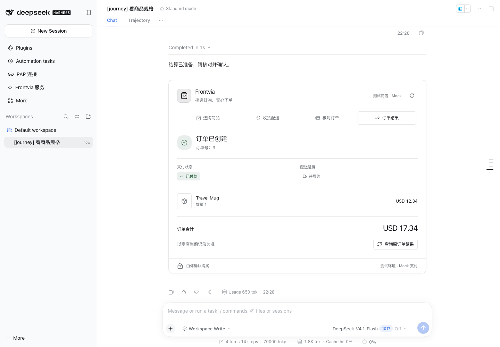
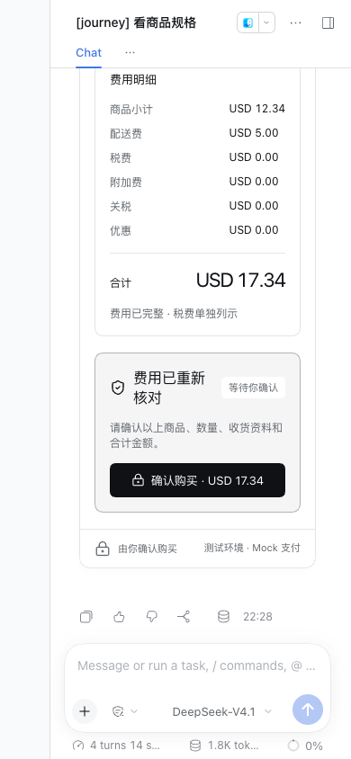

# 个人账号免审批购物验收 · 2026-11-03

本次实现将手机号个人账号接到购物车、报价、结算和订单归属。登录/注册/退出入口
位于 Frontvia 插件；PAP 插件负责连接、协议和脱敏身份展示。服务端需要
Frontvia Schema52 及 `frontvia.personal_purchase.v1`，两插件一起更新。

## PASS

- `pnpm check`：类型检查、构建和 71 项行为测试通过。覆盖连接绑定、账号切换、
  购物能力、owner 确认、结果未知恢复、实际签名和跨包错误识别。
- 独立 HTTPS / Rust Platform / Medusa / PostgreSQL / DSH 0.2.1-rc.3 实测：
  手机号登录、商品与规格、加购与数量、收货与配送、报价与结算、人工确认、
  订单查询及重载通过。个人测试栈未配置旧主体购买策略或客户端 HMAC 确认密钥。
- 可复用 `scripts/personal-commerce-check.mjs` 验证金额篡改、错误签名密钥、
  第二个人与游客越权均被拒绝，退出后原连接不可再使用。重复确认只产生
  1 笔订单和 1 次 Mock capture；夹具清理结果为 PASS。
- 真实浏览器 1440×1000 与 390×844：登录、加购、地址、报价、用户点击确认、
  订单及刷新恢复通过，console、页面和网络错误为零。受控模型完成 10 次
  实际工具调用；收货资料未进入模型请求。
- 无购买能力时，加购按钮禁用并说明原因；未显式配置 Mock 支付时不显示
  “不会实际扣款”承诺。桌面、窄屏和重载检查通过。
- 服务端实际 Capabilities、Cart、Quote、Checkout、Order 响应通过对应
  OpenRPC schema 校验。

## 边界

使用保留测试号码、隔离数据库、受控模型与原生 Mock 支付；未发送真实短信、
调用付费模型或产生真实扣款。通过的是 DSH 宿主 Web UI，未证明 Electron
应用窗口、线上商家、真实支付或生产部署。截图中的商店、商品和订单来自
已清理的测试环境，不是当前可查询的线上订单。

复现步骤见 [隔离测试栈](native-acceptance.md#个人账号免审批购物)。旧验收文档
记录的是各阶段快照，其中的审批限制不代表当前个人账号购买的要求。

## 截图

桌面订单结果：

窄屏报价和人工确认：

