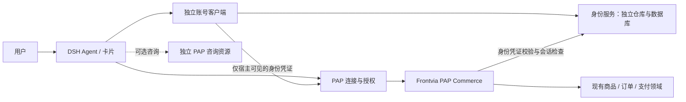

# SPEC：独立 DSH 身份服务与 PAP 直接交易

状态：Draft v0.2，已修订首轮评审的三项缺口，待契约冻结；本文不代表代码已实现、迁移已执行或生产已切换。

v0.2 修订：明确托管付款页脱离咨询购买的授权依据；补充身份数据库恢复安全纪元和账号安全状态核对；限定旧设备公开 URL 的精确兼容例外，并同步交付物和验收用例。

日期：2026-11-06。用户目标：将 DSH 个人登录服务从 Frontvia Core 抽离为独立项目；DSH 插件与 Frontvia 仅通过 PAP 交互，直接调用商品和购买 API，不以商家对外服务 Agent 对话作为购买链路。

核对基线：`dsh-frontvia-plugins/main@036a5ed`、`frontvia-core/main@30917ea`。下文“现状”来自这些版本；“必须”“目标”“新增”是待实现要求。新增协议名和接口为本项目提案，不宣称属于已发布的 PAP 标准。

## 1. 目标与边界

完成后的产品行为：

1. 用户在 DSH 的独立账号入口通过手机号验证码登录，无需先添加 Frontvia 商家。
2. 身份服务管理个人账号、登录会话和设备公开身份；账号不依附某个商家。
3. DSH Agent 通过插件工具直接查询商品、规格、库存、配送，准备购物车和报价。
4. 插件向用户展示服务端确定的订单摘要；用户在卡片中明确确认购买。
5. 插件通过 PAP 调用交易接口，展示付款入口并查询原订单状态。
6. 商家咨询 Agent 停止、未发布或模型不可用时，以上购买链路仍能完成。
7. 旧账号、设备绑定、未完成支付和历史订单保留；迁移不产生新购买或重复扣款。

“仅通过 PAP”约束：插件到 Frontvia 的业务访问限于经发现和验证的 PAP 资源 RPC、授权及元数据端点。插件不得调用 Frontvia 的旧个人登录、会话和设备登记接口，或 merchant-admin、C0、Medusa 管理接口及内部 buyer 接口。`/v1/personal/*` 仅允许第 8.2 节列出的已登记旧设备公开元数据 GET 兼容例外，不允许按目录整体放行。Frontvia 内部可调用现有交易领域适配器；PAP 不替代这些领域的业务规则。

用户主动打开的托管付款页、支付渠道页面，以及渠道回调属于独立的人机支付和服务端渠道链路，不是插件绕过 PAP 的业务 API。付款页不得向 DSH 暴露平台管理凭据，也不得依赖商家 Agent。插件查询支付结果仍走 PAP。

非目标：

- 本期不改造 Frontvia 商家后台登录；不删除其个人账号或企业成员能力。
- 不创建新的订单、支付账本或模型驱动的交易状态机。
- 不增加 Agent 自动确认购买、自动付款或自动退款的能力。
- 不做跨设备订单自动合并，也不按相同手机号自动认领历史数据。
- 不把咨询/知识服务删除；它们保留为独立、可选的 PAP 资源。
- 本 SPEC 不授权创建远程仓库、发布版本、部署、生产数据迁移或真实支付。

## 2. 已有能力与缺口

| 项目 | 现状 | 本期要求 |
| --- | --- | --- |
| 个人登录 | 插件调用 Frontvia 的 OTP、me、logout | 改为独立身份服务 |
| 本地凭据 | PAP 加密 SQLite 与 DSH credentials | 保留存储能力，调整模块归属 |
| 设备登记 | Frontvia `/v1/personal/pap/devices` | 新身份服务拥有登记与公开文档 |
| 商家身份 | PAP 表外键关联平台个人表与会话表 | 外部身份映射，取消该路径跨服务数据依赖 |
| 直接购买 | 已有 `commerce.*`、owner 确认和幂等恢复 | 复用并补齐 CN/CNY、真实支付 |
| 人民币购买 | 咨询 Agent 备单，确认消息触发购买 | 新订单仅走直接交易 API |
| 币种 | 插件直接路径仍硬编码 US/USD | 来自能力声明、报价和用户选择 |
| 历史归属 | 商家 issuer、client_id、个人主体共同约束 | 保留原约束，显式迁移映射 |

主要依据：插件 `packages/pap/src/{personal,device,core,profile,storage}.ts`、`packages/customer/src/{core,consultation,conversation-shopping}.ts`；Frontvia `platform/crates/platform-server/src/accounts/`、`platform/migrations/0051_personal_pap.sql`、`0056_pap_device_keys.sql`、`platform/docs/public-personal-pap.md` 和 `docs/api/Frontvia_Commerce_JSONRPC_API_v1.0.md`。

## 3. 仓库与运行时职责

### 3.1 新仓库：`AgentConnect/dsh-identity`（暂定名称）

- 独立构建、测试、部署、数据库迁移和回滚；不用 Frontvia 的数据库账号或共享表。
- 服务端延续当前 Rust 技术栈，迁移账号逻辑；抽取所需最小密码学/存储接口，不依赖整个 Frontvia 应用组合根。
- 拥有手机号验证、用户生命周期、会话撤销、签名密钥轮换、设备公钥与 CIMD/JWKS 文档。
- 拥有身份 HTTP 契约、JSON Schema、客户端类型及协议互操作测试材料。
- 提供宿主账号插件包（暂名 `dsh-identity-client`）：登录 UI、本地账号状态、宿主内部凭证接口。
- 身份服务不理解商品、金额、订单、商家成员或店铺配置。

### 3.2 `AgentConnect/dsh-frontvia-plugins`

- `dsh-pap` 负责发现、资源绑定、设备签名与 DPoP、令牌获取、RPC、重放保护；通过宿主账号接口获取专用身份凭证，不直接实现手机号登录。
- `dsh-frontvia-customer` 负责商品与交易工具、用户卡片、版本冲突提示、操作恢复；不持有个人登录令牌。
- Frontvia 页面显示共享身份，可导航到独立账号入口；卸载 Customer 不删除账号或设备密钥。
- 设备私钥、身份令牌及签名操作只在宿主；网页和模型不能取得密钥或通用签名接口。

### 3.3 `AgentConnect/frontvia-core`

- 通过受信任的外部身份接入契约识别 DSH 用户，再签发 Frontvia 自己的资源访问令牌。
- 保留 PAP 资源、商品/订单/支付领域及商家后台账号体系。
- 不复制 DSH 手机号、验证码、密码或个人登录会话作为新的身份事实来源。
- 外部身份服务不能授予商家后台权限；资源和购买权限仍由 Frontvia 决定。

## 4. 独立身份接口与数据

以下路径是新服务拟定契约，与 Frontvia 的旧路径分离。正式域名在部署阶段确定，不能从商家导入 JSON 修改。

| 接口 | 权限与行为 |
| --- | --- |
| `POST /v1/auth/otp/request` | 输入规范化手机号；返回 challenge、有效期、重发时间；限流 |
| `POST /v1/auth/otp/verify` | 验证一次性验证码，登录或首次注册；返回稳定用户 ID、个人令牌、有效期 |
| `GET /v1/auth/me` | 校验当前会话；返回最少账号资料与脱敏联系方式 |
| `POST /v1/auth/logout` | 撤销当前个人会话；幂等，不注销账号或删除设备历史 |
| `POST /v1/devices` | 已登录用户 + 设备持钥证明登记公钥；幂等返回 client_id |
| `GET /v1/devices/{handle}/agent.json`、`jwks.json` | 公开客户端文档和公钥，不包含手机号、令牌或私钥 |
| `POST /v1/federation/assertions` | 已登录宿主为明确目标商家申请短期身份凭证，绑定 client_id 与 DPoP 公钥 |
| `POST /v1/federation/introspect` | 仅登记的服务端调用者校验会话有效性；调用者绑定自身 audience，不能枚举用户 |

OTP 沿用现有基线：6 位、5 分钟有效、一次消费、最多 5 次错误；发送有冷却和分层限流。个人会话初始有效期 24 小时，不把过期会话静默升级为永久登录。发送结果未知不能当作投递成功。

### 4.1 数据拥有者

| 存储 | 数据 | 约束 |
| --- | --- | --- |
| 身份 PostgreSQL | users、contacts、sessions、otp_challenges、device_keys、撤销/审计记录 | 用户 UUID 稳定；手机号规范化且唯一；会话令牌和 OTP 保存带密钥摘要 |
| 身份密钥管理 | 凭证签名密钥、摘要密钥、短信配置 | 与数据库备份权限分离；支持 key version 与轮换 |
| 身份独立恢复控制存储 | 当前安全纪元、恢复门禁、账号安全变更的持久核对依据 | 不随业务数据库备份一起回退；不是第二份登录会话库 |
| DSH credentials | 本地数据加密密钥、设备私钥 | 不上传、不交给模型；使用宿主提供的凭据存储能力 |
| DSH 身份 Vault | 登录令牌、脱敏手机号、登录代次、设备引用 | 记录 AES-256-GCM 加密；目录 0700、文件 0600 |
| DSH PAP / Customer Vault | 商家连接、资源令牌、购物进度、操作键及回执缓存 | 绑定账号和设备；不是远程订单事实来源 |
| Frontvia PostgreSQL | 外部身份映射、商家授权、交易归属 | 不跨库外键；不以手机号作为用户键 |
| 原交易存储 | 地址、商品快照、订单、支付事实 | 继续由原领域拥有；身份迁移不复制或重建订单 |

身份服务目标联系人存储采用应用层密文与独立密钥的盲索引，支持相等查找及唯一约束；密文、索引分别带 key version。不得因旧库 target 为明文而声称已加密。轮换须演练双索引过渡和唯一性检查，明文导出只能存在于受限迁移环境且有销毁记录。

验证码、Bearer、手机号、私钥和付款访问链接不得进入模型上下文、通用日志或审计事件正文。收货地址只按交易需要传给商家，登录本身不分享手机号。

## 5. PAP 外部身份接入契约

### 5.1 身份凭证

定义版本化扩展 `dsh.identity_assertion.v1`。具体 grant 标识与 schema 在 P0 固化；本期不得不加协商地改变旧 `urn:frontvia:params:oauth:grant-type:personal` 的语义。

凭证由身份服务签名，至少包含：

| 字段 | 约束 |
| --- | --- |
| `iss`、`sub` | 受信任身份服务与其稳定用户 ID；二者共同标识用户 |
| `aud`、`resource` | 精确商家授权受众及资源，不允许通配 |
| `client_id`、`cnf.jkt` | 已登记设备身份及当前资源 DPoP 公钥指纹 |
| `sid`、`session_version` | 当前个人会话与安全版本，供撤销检查 |
| `identity_epoch` | 身份服务当前安全纪元；恢复后必须变化，不等同于签名密钥版本 |
| `iat`、`exp`、`jti` | 最长 60 秒、最多 5 秒时钟偏差、一次性兑换标识 |

不带手机号、企业角色、购买授权或任意金额授权。申请时验证设备持钥，并将资源 DPoP 公钥绑定到这次申请；仅提供一个 client_id 字符串不构成设备证明。

插件从已验证的 PAP metadata 判断商家是否支持该扩展。身份服务与 PAP 客户端对可信 issuer、audience 和资源来源做独立校验；商家配置不能新增身份发行者或改变个人凭据发送目的地。不支持扩展时明确显示能力不支持，不回退到发送个人登录令牌。

### 5.2 商家兑换与资源使用

1. 插件从独立账号服务取得目标绑定的短期身份凭证。
2. 插件向 Frontvia 的 PAP token 端点提交凭证、client assertion、resource 与 DPoP。
3. Frontvia 校验固定信任配置下的签名、时间、受众、设备、公钥绑定，并向身份服务检查会话。
4. 在 Frontvia 本地事务中消费 jti、建立/查找外部身份映射并签发资源令牌。并发兑换只能成功一次；回包丢失可申请新凭证，但不得创建新的商家用户。
5. 后续 RPC 使用商家签发的资源令牌与 DPoP。每次鉴权仍检查发行者、精确资源、会话、对象归属及商家自己的策略。

外部主体键为 `(identity_issuer, subject)`；商家资源主体仍按 `(merchant_issuer, client_id, external_subject)` 隔离。不得因 sub 相同但 iss 不同，或手机号相同而合并。

### 5.3 撤销与故障语义

- V1 对受保护的兑换和业务请求执行服务端在线会话检查，不使用正向有效状态缓存来放宽撤权。
- logout 成功后，后续开始的鉴权必须拒绝该会话及派生令牌；此前已通过鉴权并准入的事务可以完成，结果进入原操作记录。
- 不承诺身份服务和商家数据库之间存在分布式原子事务；以上“准入前/后”边界必须在测试与文档中一致。
- 身份服务不可用时，受保护业务返回可恢复的身份服务不可用错误，不能按游客或旧授权继续。已签名验证的支付渠道回调与账务对账继续运行，不依赖用户在线会话。
- 退出不是撤销已受理订单或退款。重新登录原账号后，只能恢复其原操作，不能重新提交为新购买。
- 日后可优化撤销分发；任何缓存方案须另行声明最大撤权延迟，不得静默弱化 V1。

### 5.4 身份数据库恢复与防止旧凭据复活

独立身份服务必须保留现有恢复保护的效果，不能仅复制账号表与在线 introspection。会话版本和 revoked 标记也会随数据库备份回退，单靠在线查询无法识别这种回退。

1. 当前 `identity_epoch` 和恢复门禁由独立恢复控制存储管理，不纳入身份业务数据库同一恢复单元。普通应用进程不能降低纪元、解除恢复门禁或自动接受快照中的旧纪元。恢复控制不可用或状态不匹配时拒绝启动认证服务。
2. 数据库恢复必须先停止认证入口并隔离全部旧实例，随后在控制存储中生成新纪元，再恢复业务数据。新实例只在业务库与控制存储纪元一致、核对完成后接流量；普通进程重启不轮换纪元。未经维护流程恢复或检测到回退时保持拒绝服务，不能自行修复为可用。
3. OTP challenge、个人会话和短期身份凭证均绑定签发纪元。恢复后所有旧 OTP、个人 Bearer 和身份凭证失效，用户重新登录；签名仍合法或尚未到期不能覆盖纪元不匹配。
4. Frontvia 在兑换时持久绑定 `identity_issuer/sub/sid/session_version/identity_epoch`，introspection 校验完整绑定并返回当前纪元。每次业务鉴权必须一致；不得拿同一用户的新会话替换旧 token 的父会话。身份服务恢复后旧派生 PAP token 必须被拒绝。
5. 纪元变化只能使旧凭据失效，不能恢复被禁用账号或旧手机号归属。账号禁用、联系方式变更与迁移映射等安全变更须有不随业务快照回退的持久核对依据；相关变更只有在该依据持久确认后才能返回成功。恢复时核对/补齐到最后确认状态，未能确认的账号禁止登录和凭证签发，不能只要求重新收一次短信就解除限制。
6. 恢复不得删除设备公钥绑定、外部主体映射或原订单；签名密钥轮换与安全纪元是两种独立操作。旧私钥泄露另行撤销，不能仅靠数据库恢复处理。

P0 必须固化独立控制存储及核对记录格式、维护权限、旧实例隔离方式、备份回退检测和恢复步骤。P1 实现并演练；未通过第 I-08/I-09 项不能进入生产迁移。

## 6. 直接交易 API

### 6.1 发现和能力声明

Commerce 作为独立 PAP resource 发布，不复用 consultation resource。即使商家只提供购物且没有咨询 Agent，也必须可发现和连接。

扩展 capabilities 的版本化 schema 至少表达：支持的国家/币种/语言、地址规则、配送能力、owner 确认方式、付款 action 类型、结果查询与幂等恢复能力。导出内容使用服务能力中立的格式；保留旧 consultation 导入的兼容读取，但不能从旧咨询配置推导交易授权。

移除插件固定 `{country: US,currency: USD}`；上下文来自商家支持项和用户选择。报价币种、卡片显示与确认签名必须一致；不从语言、手机号或商品文案猜币种。旧 US/USD 作为回归场景保留。

### 6.2 方法与调用权限

以下 Commerce 方法已在现有客户端使用，复用现有 schema、meta 和版本约束；不能统一改写为一套未经兼容的参数结构。

| 任务 | 方法 | 可调用者 |
| --- | --- | --- |
| 能力、商品和规格 | `commerce.capabilities.get`、`products.search/get`、`variants.list`（后两类均带 commerce 前缀） | Agent 工具 |
| 购物车 | `commerce.carts.create/get/update`、`carts.lines.add/update/remove` | 工具；收货资料编辑默认走 owner 卡片 |
| 配送 | `commerce.carts.delivery_options.list`、`commerce.carts.delivery_option.select` | Agent 工具或用户卡片 |
| 报价 | `commerce.quotes.create` | Agent 工具 |
| 准备和读取结算 | `commerce.checkouts.create/get` | Agent 工具；create 不构成购买确认 |
| 确认购买 | `commerce.checkouts.confirm` | 仅 owner 卡片 |
| 撤销可撤销结算 | `commerce.checkouts.cancel` | 保留现有领域门禁和明确用户意图；不能取消未知付款以规避恢复 |
| 查询订单 | `commerce.orders.list/get` | Agent 工具，严格当前主体范围 |
| 恢复原操作 | `commerce.operations.lookup` | Agent 工具或卡片；只能读取原写入结果 |

表中省略的重复前缀均为 `commerce.`。本期不新增第二套 products/orders HTTP API。Frontvia PAP 适配层直接调用现有应用服务，不能内部改成调用咨询 Agent 再解析文本。

### 6.3 地址、金额和报价

- CNY 金额使用整数分字符串；0.01 元为 `"1"`，计算不用浮点数。
- CN 地址必须包含国家、收件人、电话及完整 line1；省、市、补充地址和邮编按能力声明为可选字符串。插件不伪造或自动拆分省市。
- 报价必须包含商品、规格、数量、配送、商品金额、运费、折扣、税费和总额，以及不可歧义的有效期、版本与快照摘要。
- 库存、金额和配送以服务端报价为准；任何影响订单内容的变化使旧确认失效，需重新展示。
- 无库存、币种不支持、地址不完整、报价过期、版本冲突必须返回结构化错误，不能通过对话文本暗示继续下单。

### 6.4 购买确认

- 沿用现有 owner-only 确认入口和签名机制，绑定 issuer、resource、client、商家主体、连接 generation、cart/quote/checkout、金额、币种、快照、nonce、幂等键与有效期。
- 确认凭证最长 120 秒，且不得超过报价期限。必须确认地址和配送已纳入快照约束。
- 插件宿主校验当前会话 owner；模型工具不能访问确认接口、签名凭证或付款秘密。
- 用户确认前不调用 `commerce.checkouts.confirm`；商家回复、商品描述、聊天中的“确认购买”均不算该授权。
- 同一幂等键和相同输入返回原操作；相同键不同输入冲突。双击、重启和丢包不得产生第二个订单。

### 6.5 支付和恢复

P0 固化 Checkout 响应中的版本化 `payment_action`：类型、经验证的托管付款页 URL、到期时间、原 checkout/order 关联。初期复用托管支付宝付款页的展示与支付领域，但必须先完成下述授权入口解耦；不能把当前付款页当作直接 Commerce 已兼容的现成入口。不暴露渠道密钥或直接把二维码 URL 当浏览器跳转 URL。

#### 6.5.1 托管付款页解耦（P3 必交付）

现有 `hosted_payer.rs` 的入口查询要求 `commerce.checkouts.reserve`、已接受的 `buyer_shopping_summaries` 以及 `conversational_purchase`；`buyer_operations.rs` 的付款链接生成也受该开关控制。直接 `commerce.checkouts.confirm` 不满足这些条件。

- 为付款页提供统一的“已准入原购买”查询适配器，继续读取现有 `buyer_operations`、checkout、资源映射和原支付账本；不建立第二份可变交易状态，也不创建伪造的咨询 summary/reserve 记录来通过校验。
- 直接购买分支以已持久化的 `commerce.checkouts.confirm` 操作为授权依据，核对 tenant、store、issuer、principal/owner、连接及 generation、checkout、原生 checkout、报价快照、金额/币种和已消费确认 nonce 的一致绑定。仅有 checkout ID、已创建报价或形式有效的 URL 不足以授予付款能力。
- 操作尚未核实或原生订单未建立时只返回等待/恢复状态；确认取消、失效或不具备付款条件时禁止新的支付写入。已付款等终态只显示结果；状态仍由原支付领域决定。
- 旧咨询购买分支仅支持迁移前已经准入的 reserve 操作及其原 summary 绑定。通过持久迁移截止标记界定旧操作范围，不能在切换后通过兼容分支创建新咨询购买。
- 两分支输出同一份受限付款上下文，由现有支付领域执行操作。页面加载、状态刷新不得隐式补建订单、确认购买或发起支付。
- 直接付款能力使用可区分旧链接的版本化签名材料，绑定原购买操作、checkout、owner、商家及连接 generation、报价快照、金额、币种和期限；服务端每次请求再次核对原记录和资金状态。旧链接仅进入原兼容分支，不因签名有效而自动升级到直接购买分支。
- 付款链接是针对已准入原订单的限时能力，不是个人会话或商家访问令牌。退出不撤销已准入订单，链接在原限定范围内的继续使用须明确展示；不得用它签发新登录、扩大订单范围或绕过已关闭/撤销的付款能力。渠道回调和对账独立继续执行。
- 新模式的能力声明、确认摘要生成、付款链接签发与页面校验必须独立于 `conversational_purchase` 和 Agent 发布状态；保留咨询兼容开关不能成为直接购买前置条件。

#### 6.5.2 支付状态与恢复规则

- `commerce.checkouts.confirm` 准入一次购买，返回原结算/订单及付款动作；如渠道尚未准备好，返回 pending，而不是让模型再次确认。
- 插件只能在用户点击后打开付款页；付款页的资金写入仍经过现有支付领域与用户操作。
- 插件通过 `checkouts.get` / `orders.get` 获取权威状态；关闭页面、扫码、跳转返回、HTTP 200 均不能推断 paid。
- 支付信息中的公开状态可包括未开始、处理中、待付款、已付款、关闭、失败、结果未知及退款信息；它是原账本状态的投影，不能建第二份可独立变更的状态机。P0 必须给出原状态到公开状态的映射表。
- `result_unknown` 时仅显示核对原付款，不生成新幂等键、不创建替代订单、不自动再次付款。
- 仅当原支付领域有持久证据证明请求未发往渠道且仍允许继续时，才恢复同一订单的准备阶段；无二维码、无扣款自述、超时均不足以证明未发送。
- 迟到扣款、已取消后到账和退款继续由原账本/对账流程处理，不能被身份切换或 UI 状态覆盖。
- 轮询是只读、可取消、有时间上限；挂载、焦点恢复与刷新不会自动执行资金写入。

## 7. 插件交互和旧咨询路径

购买工具继续使用现有 `frontvia_products/cart/checkout/orders`，避免让模型新增第二套购买入口。工具描述明确结构化 API 是价格、库存、报价和状态的来源。

商品卡 → 购物车/地址 → 配送与报价 → 用户核对确认 → 付款与原订单查询。每阶段提供加载、空结果、错误、过期、冲突、处理中及重启恢复状态；订单和付款操作不能藏在咨询折叠区。

咨询与知识工具保留，默认收起问答。它们不能创建新购物确认意图，也不能接收特殊“确认购买”字符串触发购买。模型提示只是辅助，权限和服务端路由必须同时执行该边界。

切换后旧咨询产生的未完成订单通过专用兼容读取/恢复适配器关联原交易对象；不能改写成新 Commerce 订单。兼容入口必须验证原主体，只读或恢复已准入原操作，不再支持咨询备单创建新购买。

## 8. 账号、设备和交易迁移

### 8.1 映射和数据范围

- 明确迁移范围是 DSH 使用的个人身份。若同一用户还使用商家后台，Frontvia 原账号及企业关系保留；独立身份账号从切换后成为 DSH 登录的新拥有者，不承诺两边联系方式自动同步。
- 建立可审计的 `(legacy issuer, legacy user_id) -> (identity issuer, subject)` 映射。优先保留 UUID，但不能仅凭 UUID 或手机号直接认领。
- 映射来自受控数据库迁移或有效旧会话与设备证明的迁移流程；普通用户不能提交任意旧 user_id。
- 初期要求重新登录新身份服务，不复制旧 Bearer，也不重置原订单、支付状态或幂等键。

### 8.2 设备 URL

- 迁移本地设备私钥引用，保持密钥和旧 client_id；不因新插件路径不同而生成新密钥。
- 新设备使用身份服务的新域名。旧设备仅对登记表中已经核实的 `(origin, handle)` 保留以下 GET 路径：`/v1/personal/pap/devices/{handle}/agent.json`、`/v1/personal/pap/devices/{handle}/jwks.json`、`/v1/personal/pap/devices/{handle}/callback`。前两项是公开元数据；callback 只提供不建立会话、不接收凭据的兼容响应，当前身份 grant 不使用浏览器授权码回调。
- 以上为第 1 节的唯一旧个人路径例外，应在边缘按完整路径和登记 handle 代理到新服务，不依赖 302，不允许未登记 handle、其他后缀或写方法。不得代理旧 OTP、me、logout 或 `POST /v1/personal/pap/devices`；身份迁移不能靠携带新个人 Bearer 调用这些旧地址。
- 公开元数据读取不附带个人 Bearer、Cookie、验证码或签名私钥；兼容代理拒绝带 Authorization 或 Cookie 的请求，日志不记录敏感头或查询值。元数据可访问不代表设备已获商家授权。PAP 端点及元数据校验仍执行原公网地址、固定目标、TLS 和可信来源约束。
- 旧域名响应的文档继续声明原 client_id 和对应 URL，公钥与原注册绑定一致；不能换成新域名身份后声称兼容。
- Frontvia 保留原 merchant principal，将外部身份映射绑定到已核实的原主体；原订单、连接 generation、交易记录不重写。
- 密钥丢失不能使用手机号恢复设备所有权；展示新设备状态，历史订单走另行定义的人工或多重证明恢复流程，本期不自动合并。

### 8.3 本地存储迁移

- 新账号模块首次运行获得 Profile 迁移锁，备份原受限文件，校验原 Vault 可解密，再复制所需账号引用/设备记录。
- 新存储验证成功后写入幂等迁移标记并切换 owner；失败维持旧可读取状态，不能生成替代私钥或删除旧库。
- PAP/Customer 连接记录保留原 ID，显式更新身份绑定映射；当前有效旧会话停用后提示重新登录。
- 不把用户全部聊天历史迁入身份服务。Customer 业务缓存和宿主聊天历史继续各自由原 owner 管理。

### 8.4 切换与回滚

1. 在隔离数据库演练用户/设备/订单映射，统计匹配、冲突、孤立项；冲突不能自动合并。
2. 部署兼容版本，先支持外部身份和直接 CNY，尚不切换全量用户。
3. 对迁移范围短时冻结相关账号变更，完成一致性快照与映射核验；商家交易账本不迁移。
4. 按账号/设备逐步切换。每个 flow 固定认证和购买路径，中途不从新路径回退到咨询购买。
5. 新购买只允许 Commerce；旧交易继续通过原 ID 恢复。确认离开咨询写入链路后停止其创建新购买能力。
6. 回滚优先关闭新购买，保留查询、渠道回调和对账。已准入的新交易仍由支持新身份的兼容版本处理；不能回滚到不认识新主体的二进制后丢失订单访问。

上线门禁：备份与恢复演练完成且旧凭据不复活、映射无未处置冲突、旧 URL 精确例外可用、旧订单可读、关闭咨询购买开关后直接付款可用、撤权和支付恢复验收通过。不得以切换成功为由删除旧数据。

## 9. 实施阶段与交付物

| 阶段 | 主要工作 | 完成证据 |
| --- | --- | --- |
| P0 契约冻结 | 固化身份扩展与恢复控制、信任配置、RPC schema、付款上下文与链接版本、支付状态投影、旧路径精确例外 | 三方 schema/样例、恢复步骤、兼容矩阵、错误契约；明确方法现状与新增项 |
| P1 身份服务 | 新仓库、独立数据库、OTP/会话/设备、凭证和 introspection、独立安全纪元与恢复门禁、宿主账号模块 | 隔离数据库集成、密钥轮换、账号隔离、安装迁移及旧备份恢复测试 |
| P2 PAP 接入 | Frontvia 外部身份验证、完整父会话/纪元绑定、映射、撤销和资源鉴权；保留后台账号 | 双服务真实 TLS/PG 集成；证明不直读身份数据库且恢复后旧 PAP token 失效 |
| P3 直接 CNY | 复用领域服务补齐报价/配送/地址/支付与卡片；解耦 hosted_payer 与付款链接签发，隔离旧兼容分支 | 关闭咨询购买开关并停止商家 Agent 后完成受控端到端交易；未确认订单不能取得付款权限 |
| P4 迁移演练 | 旧设备 URL 精确代理、账号映射、本地 Profile、旧订单与未知支付恢复 | 旧数据样本的迁移、路径边界、重复执行、中断恢复和回滚报告 |
| P5 安装与切换 | 小范围安装、按需增量部署、灰度观察 | 独立授权后进行；记录真实 DSH 与真实渠道验收范围 |

优先复用现有商品、报价、订单和支付实现。新增身份服务独立构建部署；Frontvia 与插件只构建受影响产物，不默认整体重编译所有服务。仓库创建、提交/PR、合并、安装、部署和真实支付按实际请求分别获得授权。

## 10. 验收矩阵

| 编号 | 场景 | 必须满足 |
| --- | --- | --- |
| I-01 | 未添加商家时验证码登录 | 独立身份服务完成注册/登录，Frontvia 无登录请求 |
| I-02 | 重复手机号、OTP 重放/过期/错误、发送未知 | 不重复建号，不越过限流或一次消费 |
| I-03 | 重启、换账号、退出时在途响应 | 身份不串号，迟到响应不能恢复已退出账号 |
| I-04 | 注入 issuer、错误 aud/resource、伪造设备和 jkt、未知签名键 | 兑换拒绝；商家 JSON 不能扩大身份信任 |
| I-05 | 多副本并发兑换、回包丢失、签名密钥轮换 | jti 单次消费、主体不重复、合法轮换可用 |
| I-06 | logout/封禁后使用旧 PAP token | 后续鉴权拒绝；已准入原操作仍可在原主体重新登录后核对 |
| I-07 | 身份服务断网 | 受保护新请求失败可恢复；支付回调和账务对账继续 |
| I-08 | 退出后恢复到撤销前备份，使用旧 Bearer、OTP、身份凭证及 PAP token | 恢复新纪元下全部拒绝；原账号重新登录后仍可核对原订单 |
| I-09 | 封禁或变更手机号后恢复旧备份；控制存储不可用、旧实例未隔离、未授权快照回退 | 未完成安全状态核对前不接认证流量；已封禁账号及旧联系方式不能恢复登录 |
| C-01 | 商家 Agent 停止、无咨询连接、关闭 conversational_purchase，且无咨询 summary/reserve | 直接 confirm 后付款页可用，商品到购买/付款查询成功，不调用 conversation RPC |
| C-02 | CNY 0.01、运费、优惠、完整地址无省市 | 正确显示并签名整数金额，直接交易可完成 |
| C-03 | US/USD 已有流程 | 原能力、确认和查询不回归 |
| C-04 | 库存/报价/地址/版本变化 | 旧确认拒绝，必须重新展示；不静默接受新价格 |
| C-05 | 模型或商家文案尝试确认/付款 | 无 owner 操作无法调用确认与资金写入 |
| C-06 | 双击、断网、重启、响应丢失、重复键不同输入 | 同一购买最多一次；冲突拒绝；按原键恢复 |
| C-07 | 无二维码、渠道超时、请求确定未发送、迟到到账 | 分别遵循原资金事实，不把未知当失败，不重复支付 |
| C-08 | 跨账号/设备/商家查询或修改订单 | 拒绝越权；公开订单 ID 不能替代授权 |
| C-09 | 未确认 checkout、伪造付款操作关联、修改金额/owner/generation、过期或跨订单链接 | 页面和支付写入拒绝；已付款/未知状态不能因打开链接产生新支付 |
| C-10 | 新 confirm 与旧 reserve 两类付款页，旧链接尝试新分支、切换后新建 reserve | 原记录分别恢复；不创建伪 summary、不接受跨分支升级、不接受新咨询购买 |
| M-01 | 旧用户、旧 client_id、旧待支付及已支付订单 | 映射前后归属不变；旧元数据 URL 不失效 |
| M-02 | 本地迁移中断/重复执行/密钥缺失 | 可恢复、不重复迁移、不生成替代身份认领旧订单 |
| M-03 | 新交易产生后的回滚 | 原订单仍可查，回调不停，不重新走咨询链路下单 |
| M-04 | 已登记旧设备的三个公开 GET；未登记 handle、POST、旧 OTP/me/logout 和携带个人凭据的读取 | 仅精确公开读取兼容；其余不进入身份兼容代理，插件不发送个人凭据到旧域名 |
| U-01 | 实际 DSH 桌面与窄屏、鼠标与键盘 | 登录、购物卡、确认、取消、刷新、重载、错误及默认折叠可用 |

验证顺序：领域/内存规则 → PostgreSQL 与服务适配器 → 双服务 HTTP/TLS/PAP → 实际插件 UI。使用受控商品、短信发送器和支付网关，禁止让测试依赖商家 LLM 生成交易事实。

网络验收须采集脱敏请求目的地、方法与路由类别：插件无 Frontvia 旧个人登录/会话/登记写入、admin/C0 请求；旧 `/v1/personal/*` 仅允许第 8.2 节已登记设备的精确公开 GET，且不携带个人凭据。无 `consultation.messages.submit` 购买请求；Frontvia 内部调用链也不能进入商家 Agent 购买逻辑。验收记录不得保存完整付款链接、认证头或手机号。

测试、合并、安装、部署、真实短信与真实付款分别报告 PASS / BLOCKER / UNVERIFIED；本地模拟通过不等于真实支付宝验收。浏览器验证遵循用户指定工具，不使用 Playwright 控制 Chrome。

## 11. 评审和实施前需定稿的配置

- 新仓库名与身份服务正式域名；本稿暂用 `dsh-identity`，不创建远程资源。
- 生产迁移账号集合、旧域名兼容路径的持续维护责任和期限；不能在旧订单可访问需求仍存在时任意停服。
- 外部身份 grant 的正式标识、PAP metadata 字段名及 token 返回 schema；先实现契约测试，再改消费者。
- 身份服务的服务端认证方式、超时与可用性目标，以及在线撤销检查容量预算；不能以性能压力私自增加有效状态缓存。
- 独立恢复控制存储、账号安全变更核对记录及快照回退检测的具体实现；必须满足第 5.4 节，不能降级为仅在恢复文档中提醒操作员退出登录。
- 托管付款页统一付款上下文、直接确认与旧 reserve 的分支校验、付款链接版本、渠道状态映射及原订单恢复方法；新增字段必须经 schema 与消费者共同评审，不得继续依赖咨询购买开关。

以上配置不改变本 SPEC 的核心决策：独立身份拥有者、PAP 作为插件到商家的唯一业务通道、结构化直接购买、用户明确确认、旧归属保留。
